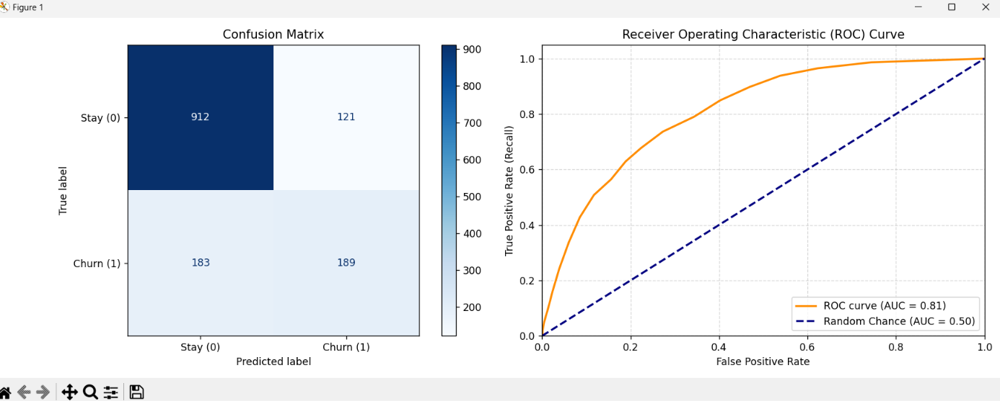
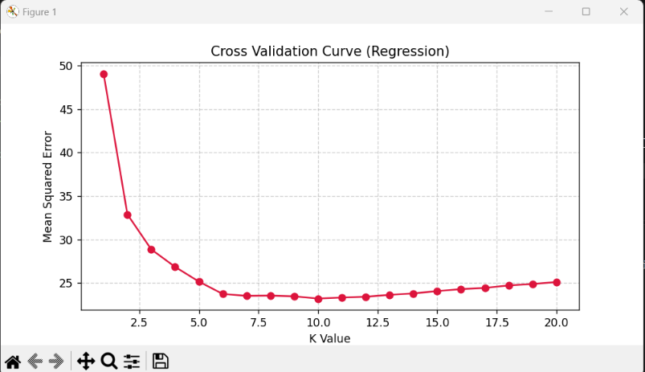
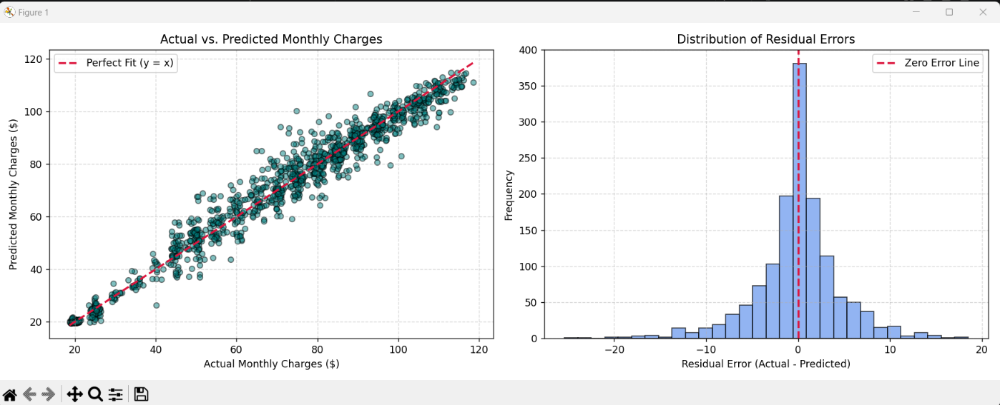

# Customer Churn & Billing Intelligence System

An end-to-end Machine Learning web application and analytics dashboard developed to predict customer churn risk, forecast monthly billing charges, and optimize customer retention strategies.

## Business Objective

Identify customers at high risk of cancelling their subscriptions, determine the underlying service and contract drivers behind customer churn, and provide management with data-driven recommendations and revenue-at-risk assessments to improve customer retention and protect profitability.

## Dashboard Pages

### 1. Single Customer Predictor

Enables retention and support representatives to configure individual customer attributes in real time, evaluate estimated monthly charges via regression, assess churn risk probability via classification, and receive instant alert guidance.

### 2. Executive Retention Summary

Provides management with a high-level summary of total evaluated accounts, count of customers requiring retention action, average churn risk, and total monthly and annualized revenue at risk.

### 3. Actionable Retention Outreach List

Provides an interactive data table with quick-filtering options to isolate high-risk customers, assign automated retention offers, and export actionable CSV campaign files.

### 4. Visual Analytics Dashboard

Compares customer risk against predicted monthly charges using interactive Plotly scatter plots with a 60% retention action threshold, alongside monthly revenue loss by contract type.

## Model Training & Evaluation Results

The machine learning models are trained using 5-fold cross-validation to select optimal hyperparameters for both classification and regression tasks.

### 1. Classification Performance (Predicting Churn)

* **Algorithm**: K-Nearest Neighbors Classifier (`KNeighborsClassifier`)
* **Optimal Hyperparameter**: Best $K = 20$
* **Accuracy Score**: 78.36%
* **ROC-AUC Score**: 0.8107

#### Classification Report:
| Metric | Class 0 (Stay) | Class 1 (Churn) | Overall / Macro Avg | Weighted Avg |
| :--- | :---: | :---: | :---: | :---: |
| **Precision** | 0.83 | 0.61 | 0.72 | 0.77 |
| **Recall** | 0.88 | 0.51 | 0.70 | 0.78 |
| **F1-Score** | 0.86 | 0.55 | 0.71 | 0.78 |
| **Support** | 1,033 | 372 | 1,405 | 1,405 |

### 2. Regression Performance (Predicting Monthly Charges)

* **Algorithm**: K-Nearest Neighbors Regressor (`KNeighborsRegressor`)
* **Optimal Hyperparameter**: Best $K = 10$
* **Mean Absolute Error (MAE)**: \$3.0865
* **Mean Squared Error (MSE)**: 21.4470
* **Root Mean Squared Error (RMSE)**: \$4.6311
* **$R^2$ Score**: 0.9757

## Key Performance Indicators

- Total Evaluated Customers (7,043)
- High-Risk Retention Count (1,253 Accounts with Risk ≥ 60%)
- Average Churn Risk % (29.1%)
- Monthly Revenue at Risk ($)
- Annualized Revenue Impact ($)
- Churn Risk Probability Score (%)
- Estimated Monthly Charges ($)
- Classification ROC-AUC Score (0.8107)
- Regression Model $R^2$ Score (0.9757)

## Dataset

This project uses the Telco Customer Churn dataset.

- Approximately 7,043 records
- 21 columns
- Includes customer demographics, account tenure, contract terms, payment methods, monthly charges, internet services, and churn status

## Project Workflow

1. Imported and explored the raw customer dataset
2. Cleaned and transformed data by handling missing values in total charges and removing non-predictive identifiers
3. Encoded target variables and performed one-hot encoding on categorical attributes
4. Applied feature scaling using `StandardScaler`
5. Trained and tuned a K-Nearest Neighbors (KNN) Classifier for churn risk prediction
6. Trained and tuned a K-Nearest Neighbors (KNN) Regressor to estimate monthly billing charges
7. Evaluated models using Confusion Matrices, ROC-AUC curves, MAE, MSE, and R² scores
8. Serialized the trained pipeline artifacts using Joblib
9. Developed an interactive Streamlit web application with Single and Batch prediction modes
10. Built business retention rules, value tier segmentation, and automated CSV export capabilities

## Tools and Skills

- Python
- Streamlit
- Scikit-Learn
- Pandas & NumPy
- Plotly Express
- Matplotlib
- Data Cleaning
- Data Preprocessing
- Classification & Regression
- Model Serialization (Joblib)
- KPI Development
- Business Insights & Retention Analysis

## Project File

Run `streamlit run app.py` to launch the interactive web dashboard locally, or access the live deployed Streamlit application.

## Project Status

Completed — dual classification and regression models trained, pipeline artifacts saved, and full interactive Streamlit web dashboard implemented with single and batch inference capabilities.
